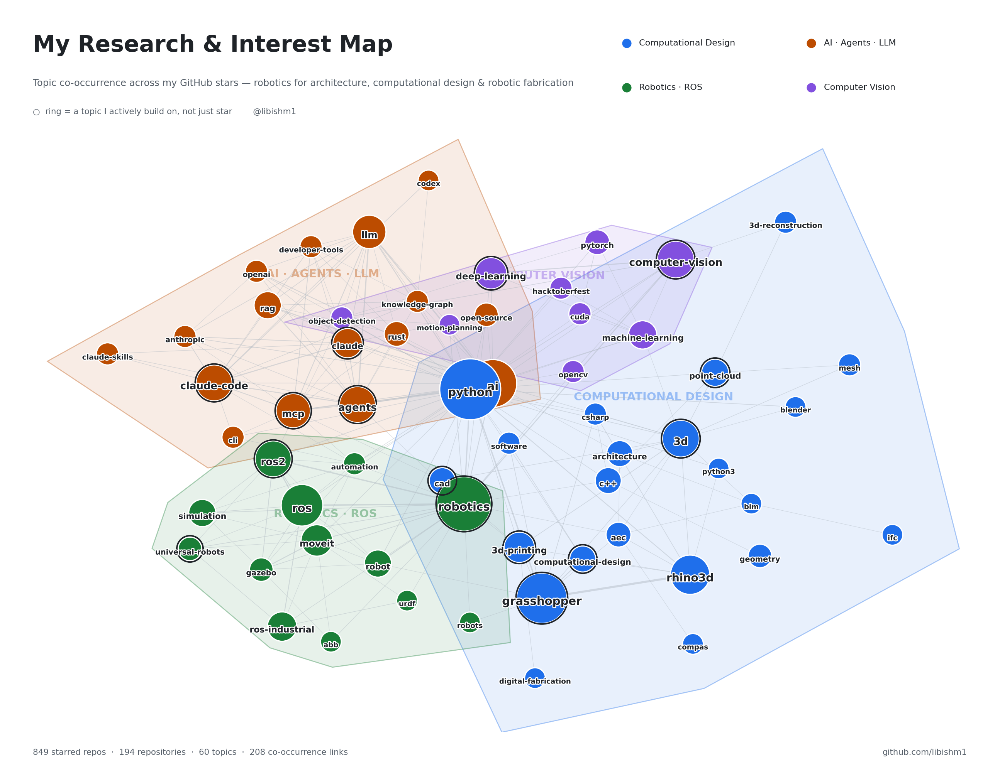

# Libish Murugesan

**Architect and robotics researcher.** I build the perception, geometry and robot software that lets machines work with material that does not come in standard sizes: fractured stone, salvaged shards, irregular logs, offcuts.

Research Assistant at Alfaisal University, Riyadh (digital fabrication and robotic manipulation) · MRAC, IAAC Barcelona · B.Arch, SPA Vijayawada

[Portfolio](https://libishm1.github.io/portfolio/) · [ORCID](https://orcid.org/0009-0004-3238-4202) · [LinkedIn](https://www.linkedin.com/in/libish-murugesan/) · [Instagram](https://www.instagram.com/libish_m/)

  
  
  

---

## What I do

**Stone, from quarry to building.** I look under the quarry floor with ground-penetrating radar, plan blocks that avoid the cracks, and pack irregular stones into walls, arches and vaults that are checked for stability before anything is cut.

**Robotic fabrication with irregular material.** Scan-to-fabricate pipelines where a robot sees each piece, plans where it fits and places it: demolition stone, logs, pine offcuts, aluminium sheet.

**Sensing and heritage reconstruction.** Photogrammetry, monocular depth and registration turned toward temples, stone labyrinths and quarries, released with open code and datasets.

**Tools other people can open.** A Grasshopper plugin, browser apps for IFC and carving, a robot stack that rebuilds from one Docker image, and agent skills for computational designers.

---

## Selected work

| Project | What it is | Links |
|---|---|---|
| **Frahan StonePack** | Rhino 8 / Grasshopper plugin for stone fabrication: 275 components from GPR and scan ingest to block cutting, nesting, masonry, stability checks and IFC / robot export | [repo](https://github.com/libishm1/Frahan) · [DOI](https://doi.org/10.5281/zenodo.21209689) |
| **Kuppam GPR Fracture Study** | Radar over three dolerite benches, six fracture surfaces re-tracked (14,315 picks), registered onto photogrammetry, and a straight-cut plan of 42 blocks | [live model](https://libishm1.github.io/Kuppam_granite-deposit_GPR-Fracture_study/) · [repo](https://github.com/libishm1/Kuppam_granite-deposit_GPR-Fracture_study) · [dataset](https://doi.org/10.6084/m9.figshare.33690616) |
| **Topologic Studio** | Browser IFC fire-egress simulation with live re-routing and a Q-learning agent. Original author Wassim Jabi; I extended it | [demo](https://libishm1.github.io/Topologic_Studio/) · [repo](https://github.com/libishm1/Topologic_Studio) |
| **UR10e + RG6 stacking** | Pick-and-place on ROS 2 Humble + MoveIt 2 in WSL2, sim and real arm, RS-485 gripper bridge, Docker workspace | [repo](https://github.com/libishm1/UR-10e_RG6_stacking_ROS2_wsl_gh) |
| **robot_webapp** | UR10e controller in the browser: URDF in Three.js, live IK, waypoints, URScript export | [repo](https://github.com/libishm1/robot_webapp) |
| **Digital Pointing Machine** | The sculptor's pointing machine rebuilt as an offline web app: exact drill depths from a scan to a stone block | [app](https://libishm1.github.io/Digital_pointing_machine/) · [repo](https://github.com/libishm1/Digital_pointing_machine) |
| **Temple motif depth** | One smartphone photo of a Tamil bas-relief to a watertight STL with Depth Anything 3; 35-panel mesh corpus | [repo](https://github.com/libishm1/Depth_Anything_3_Motifs_CLI) · [corpus](https://doi.org/10.5281/zenodo.19846595) |
| **Drone photogrammetry of stone labyrinths** | Drone video to textured mesh and 3D print, FFmpeg → COLMAP → Open3D in Colab | [repo](https://github.com/libishm1/Colmap_Photogrammetry_Drone_video) |
| **Semi-automatic ICP** | Coarse + fine Open3D registration to compare photogrammetry methods | [repo](https://github.com/libishm1/Semi_automatic_ICP_open3D) |
| **stonepacking · aggregation** | Small browser experiments in stone packing and rule-based aggregation | [stonepacking](https://libishm1.github.io/stonepacking/) · [aggregation](https://libishm1.github.io/aggregation/) |
| **3DCP research graph** | Interactive literature graph and table for 3D concrete printing | [open](https://libishm1.github.io/3DCP_research/) |

The full set, including robotic fabrication studio work from IAAC and IISc, is on the [portfolio](https://libishm1.github.io/portfolio/).

## Publications

- Alammar, Alymani, Alsofiani, **Murugesan**, Latif (2026). *Towards Climate-Resilient Office Façades: Integrating PCM-Enhanced Glazing with Dynamic External Louvres Under Current and Future Hot–Arid Climates.* Sustainability 18(19), 10168. [doi:10.3390/su181910168](https://doi.org/10.3390/su181910168)
- **Murugesan** (2026). *A managed, uncertainty-aware pipeline from ground-penetrating radar to dimension-stone block yield in fractured quarries.* Research Square preprint, not yet peer reviewed. [doi:10.21203/rs.3.rs-10035624/v1](https://doi.org/10.21203/rs.3.rs-10035624/v1)
- **Murugesan** (2026). *The Salem Labyrinth: Creating a 3D Model from Drone Footage.* Caerdroia 55. [PDF](https://labyrinthos.net/Caerdroia55HR.pdf)
- **Murugesan** (2025). *Two Labyrinths Rediscovered in Salem, India.* Caerdroia 54. [PDF](https://labyrinthos.net/Caerdroia54HR.pdf)
- Papandreou, Baseta, Mathe, Blackburn, **Murugesan** (2022). *Programming Twist: Exploring the geometric affordances of aluminum through flexible robotic workflows.* eCAADe 2022. [doi:10.52842/conf.ecaade.2022.2.399](https://doi.org/10.52842/conf.ecaade.2022.2.399)

Datasets and software releases on Zenodo and figshare are listed on the [portfolio](https://libishm1.github.io/portfolio/#publications) and [ORCID](https://orcid.org/0009-0004-3238-4202).

## Teaching and AI tooling

- [SURE-program_python-intro](https://github.com/libishm1/SURE-program_python-intro): summer course scripts, from Python syntax to CAM toolpaths on a simulated robot arm
- [Math4Stone](https://github.com/libishm1/Math4Stone): Anki deck of about 1,000 derivation cards for the maths behind scan → CAD → IFC and robotic stone fabrication
- [computational-design-skill](https://github.com/libishm1/computational-design-skill): agent skills for Grasshopper, Topologic / IFC, fabrication and debugging
- [Agent-orchestration](https://github.com/libishm1/Agent-orchestration): project memory that survives switching between Claude Code, Codex and local models

## Stack

- **Robots:** UR10e · KUKA · ABB · ROS 2 · MoveIt 2 · ur_rtde · OnRobot RG6
- **Geometry:** Rhino 8 · Grasshopper · C# · Python · Three.js · IFC · TopologicPy
- **Sensing:** GPR · photogrammetry (COLMAP) · Open3D · Depth Anything · OpenCV · RealSense

Interest map from my GitHub stars

  <picture>
    <source media="(prefers-color-scheme: dark)" srcset="libishm1_research_map_dark.png">
    <source media="(prefers-color-scheme: light)" srcset="libishm1_research_map_light.png">
    
  </picture>

Text and images © 2026 Libish Murugesan. Code is under each repository's own license.
